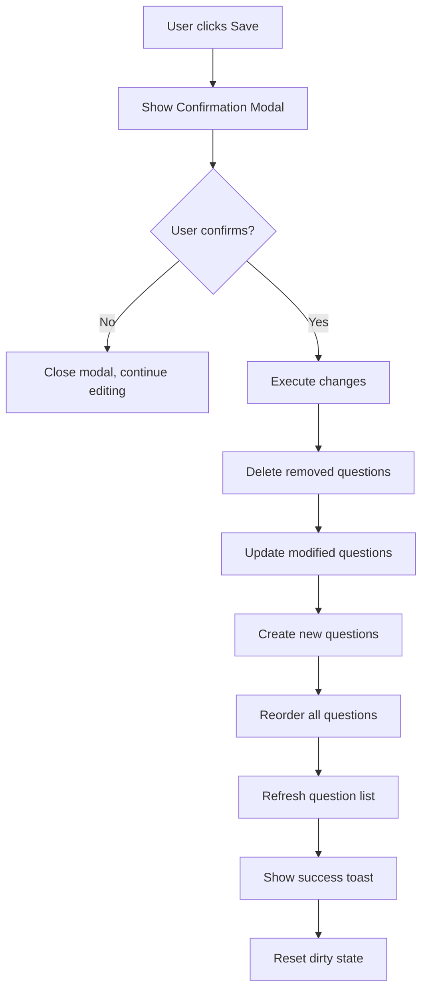

# Admin Applications Page - Implementation Plan

## Overview

Build an admin interface for managing application questions with inline editing, reordering, preview, and confirmation workflow.

## Requirements Summary

- **Question Management**: Add, edit, delete questions
- **Reordering**: Up/down arrow buttons to change question order
- **Editing**: Modal-based editing for existing questions
- **Add Form**: Form at bottom of list for adding new questions
- **Preview Pane**: Real-time preview showing how questions appear to applicants
- **Confirmation**: Modal showing summary of changes before saving
- **Theme**: Match existing admin UI (#191919, #f4f4f4, #e0e0e0)

## Data Model (from Prisma Schema)

```typescript
Question {
  id: string (cuid)
  title: string
  type: QuestionType (MULTIPLE_CHOICE | DROPDOWN | NUMBER | CHECKBOX | SHORT_TEXT | LONG_TEXT)
  order: int (default: 0)
  required: boolean (default: false)
  targetRole: Role[] (HACKER | JUDGE | MENTOR | VOLUNTEER | ORGANIZER | ADMIN | UNDECLARED)
  placeholder: string?
  options: string[] (for MULTIPLE_CHOICE, DROPDOWN)
  min: float? (for NUMBER)
  max: float? (for NUMBER)
  regex: string? (for validation)
  linkedField: string? ("name" | "university" | "year")
}
```

## Existing tRPC Endpoints

Available in [`questions.ts`](../src/lib/server/trpc/routers/questions.ts):

- `listAll` - Get all questions ordered by order field
- `create` - Create new question
- `update` - Update existing question
- `delete` - Delete question
- `reorder` - Batch update order values

## Architecture

### Component Structure

```
src/routes/admin/Applications/+page.svelte (Main Page)
src/components/admin/Applications
├── QuestionList (left side, 60%)
│   ├── QuestionListItem (repeating)
│   │   ├── Question display
│   │   ├── Edit button → opens QuestionEditor modal
│   │   ├── Delete button
│   │   ├── Up/Down arrows
│   └── AddQuestionForm (at bottom)
└── PreviewPane (right side, 40%)
    └── QuestionRenderer (reused from applicant view)

Modals:
├── QuestionEditor (for add/edit)
└── ConfirmationModal (before save)
```

### State Management Strategy

```typescript
// Main page state
let questions = $state<Question[]>([]);           // Current questions from DB
let workingQuestions = $state<Question[]>([]);    // Local working copy
let pendingChanges = $derived({
  added: Question[],      // New questions (no id yet)
  modified: Question[],   // Changed existing questions
  deleted: string[],      // IDs of deleted questions
  reordered: boolean      // Whether order changed
});
let isDirty = $derived(pendingChanges has any changes);
```

### Page Layout

```
┌─────────────────────────────────────────────────────────┐
│ Applications                                    [Save]  │
├──────────────────────────┬──────────────────────────────┤
│ Question List (60%)      │ Preview Pane (40%)          │
│                          │                              │
│ ┌──────────────────────┐ │ ┌──────────────────────────┐│
│ │ 1. Question Title    │ │ │ Role: [HACKER ▼]         ││
│ │    Type: SHORT_TEXT  │ │ │                          ││
│ │    [Edit] [Delete]   │ │ │ Preview as Applicant     ││
│ │    [↑] [↓]          │ │ │                          ││
│ └──────────────────────┘ │ │ Question 1               ││
│                          │ │ [input field]            ││
│ ┌──────────────────────┐ │ │                          ││
│ │ 2. Another Question  │ │ │ Question 2               ││
│ │    ...               │ │ │ [dropdown]               ││
│ └──────────────────────┘ │ │                          ││
│                          │ │ ...                      ││
│ [Add Question Form]      │ └──────────────────────────┘│
│ ┌──────────────────────┐ │                              │
│ │ Title: [_________]   │ │                              │
│ │ Type: [dropdown]     │ │                              │
│ │ [+ Add Question]     │ │                              │
│ └──────────────────────┘ │                              │
└──────────────────────────┴──────────────────────────────┘
```

## Component Details

### 1. QuestionListItem Component

**File**: `src/lib/components/admin/QuestionListItem.svelte`

**Props**:

- `question: Question`
- `canMoveUp: boolean`
- `canMoveDown: boolean`
- `onEdit: () => void`
- `onDelete: () => void`
- `onMoveUp: () => void`
- `onMoveDown: () => void`

**Display**:

- Question number and title
- Question type badge
- Required indicator
- Target roles (if specified)
- Action buttons (Edit, Delete, ↑, ↓)

### 2. QuestionEditor Component

**File**: `src/lib/components/admin/QuestionEditor.svelte`

**Props**:

- `question: Question | null` (null for new question)
- `isOpen: boolean`
- `onSave: (question: Partial<Question>) => void`
- `onCancel: () => void`

**Form Fields**:

- Title (text input, required)
- Type (dropdown, required)
- Required (checkbox)
- Target Roles (multi-select checkboxes)
- Placeholder (text input, conditional)
- Options (dynamic list, for MULTIPLE_CHOICE/DROPDOWN)
- Min/Max (number inputs, for NUMBER type)
- Regex (text input, optional)
- Linked Field (dropdown: none/name/university/year)

**Conditional Fields**:

- Show Options only for MULTIPLE_CHOICE, DROPDOWN
- Show Min/Max only for NUMBER
- Show Placeholder for all except CHECKBOX, MULTIPLE_CHOICE

### 3. PreviewPane Component

**File**: `src/lib/components/admin/PreviewPane.svelte`

**Props**:

- `questions: Question[]`

**Features**:

- Reuses existing [`QuestionRenderer.svelte`](../src/lib/components/application/QuestionRenderer.svelte)
- Shows questions in order as they appear to applicants
- Read-only preview (no actual form submission)
- Scrollable if many questions

### 4. ConfirmationModal Component

**File**: `src/lib/components/admin/ConfirmationModal.svelte`

**Props**:

- `isOpen: boolean`
- `changes: { added: Question[], modified: Question[], deleted: Question[], reordered: boolean }`
- `onConfirm: () => void`
- `onCancel: () => void`

**Display**:

Shows detailed list of changes with question titles:

```
┌─────────────────────────────────────────┐
│ Confirm Changes                         │
├─────────────────────────────────────────┤
│ You are about to make these changes:    │
│                                         │
│ Added Questions:                        │
│ • What is your name?                    │
│ • What is your university?              │
│                                         │
│ Modified Questions:                     │
│ • What is your major? (updated)         │
│                                         │
│ Deleted Questions:                      │
│ • Previous question title               │
│                                         │
│ Questions Reordered: Yes                │
│                                         │
│ [Cancel]  [Confirm & Save]              │
└─────────────────────────────────────────┘
```

**Notes**:

- Each section only shows if there are changes in that category
- Question titles are truncated if too long (max 60 chars)
- Scrollable if many changes

## Implementation Workflow

### Phase 1: Setup & Data Loading

1. Fetch all questions using `trpc.questions.listAll`
2. Initialize working copy of questions
3. Set up reactive state for tracking changes

### Phase 2: Component Development

1. Build QuestionListItem component
2. Build QuestionEditor modal
3. Build PreviewPane component
4. Build ConfirmationModal component

### Phase 3: Main Page Integration

1. Create main page layout (2-column grid)
2. Implement question list rendering
3. Add "Add Question" form at bottom
4. Integrate preview pane

### Phase 4: Interaction Logic

1. Implement edit functionality (open modal, save changes)
2. Implement delete functionality (mark for deletion)
3. Implement reorder (up/down arrows, update order values)
4. Implement add question (from bottom form)

### Phase 5: Save & Confirmation

1. Track all changes in derived state
2. Show "Save" button when dirty
3. Open confirmation modal on save click
4. Batch execute all changes via tRPC
5. Refresh question list after save

### Phase 6: Polish

1. Add loading states
2. Add error handling with Toast notifications
3. Add unsaved changes warning
4. Test complete workflow

## Change Tracking Strategy

```typescript
// Track changes by comparing workingQuestions with original questions
const pendingChanges = $derived(() => {
  const added = workingQuestions.filter(
    (q) => !q.id || q.id.startsWith("temp-"),
  );
  const deleted = questions.filter(
    (q) => !workingQuestions.find((wq) => wq.id === q.id),
  );
  const modified = workingQuestions.filter((wq) => {
    const original = questions.find((q) => q.id === wq.id);
    return original && JSON.stringify(original) !== JSON.stringify(wq);
  });
  const reordered = workingQuestions.some((q, i) => q.order !== i);

  return { added, modified, deleted: deleted.map((q) => q.id), reordered };
});
```

## Save Operation Flow



## Styling Guidelines

**Colors** (from existing theme):

- Primary text: `#191919`
- Secondary text: `#aaaaaa`
- Background: `#f4f4f4`
- Card background: `#fff`
- Border: `#e0e0e0`
- Accent (buttons): `#191919`
- Success: `#16a34a`
- Error: `#b00000`

**Component Styles**:

- Cards: white background, border, rounded corners, subtle shadow
- Buttons: rounded, padding, hover states
- Inputs: border, rounded, focus states
- Modal: overlay with centered card

## Error Handling

1. **Network errors**: Show error toast, don't clear working state
2. **Validation errors**: Show inline validation messages
3. **Concurrent edits**: Refresh on save failure, show conflict message
4. **Delete with responses**: Backend handles cascade delete (see schema)

## Testing Checklist

- [ ] Load questions from database
- [ ] Add new question via bottom form
- [ ] Edit existing question via modal
- [ ] Delete question
- [ ] Reorder questions with up/down arrows
- [ ] Preview updates in real-time
- [ ] Save shows confirmation modal with correct counts
- [ ] Confirm saves all changes to database
- [ ] Cancel confirmation keeps working state
- [ ] Unsaved changes warning on navigation
- [ ] Error handling for network failures
- [ ] Loading states during operations

## Files to Create/Modify

**New Files**:

- `src/lib/components/admin/QuestionListItem.svelte`
- `src/lib/components/admin/QuestionEditor.svelte`
- `src/lib/components/admin/PreviewPane.svelte`
- `src/lib/components/admin/ConfirmationModal.svelte`

**Modified Files**:

- `src/routes/admin/Applications/+page.svelte` (main implementation)

**Existing Files to Reference**:

- `src/lib/components/application/QuestionRenderer.svelte` (for preview)
- `src/lib/server/trpc/routers/questions.ts` (tRPC endpoints)
- `prisma/schema.prisma` (Question model)
- `src/routes/admin/+layout.svelte` (theme reference)
